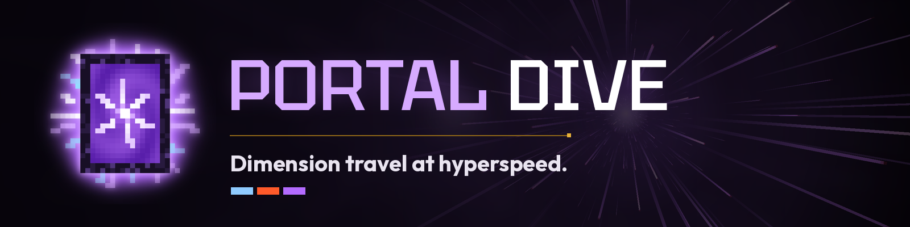
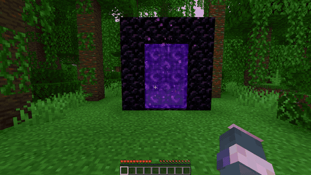

# Portal Dive

Client-side NeoForge mod that turns dimension changes into a hyperspace jump.

- **Windup:** stars start streaking and the FOV creeps out while you stand in a Nether portal.
- **Dive:** the "Loading terrain" screen becomes a hyperspace tunnel. Streaks stretch, the view punches out, the screen shakes. It cruises for as long as chunks take to load (1.4 s minimum so fast loads still feel like a jump).
- **Hyper-braking:** on arrival the streaks snap down to dots, the FOV slams back with a spring, a flash fires and the camera jolts and rumbles before settling.
- **Tinted per dimension:** Overworld blue-white, Nether red-orange, End purple. Modded dimensions get a colour from their id, or set one in the config.
- Shows the destination name, has its own sounds and mutes the vanilla travel sound during the dive.

Client only. Works on any server, vanilla included. Works with modded dimensions too (tested with The Aether, The Undergarden and Deeper and Darker), and takes over their own transition screens unless you turn that off.

## Config

`config/portaldive-client.toml`, or Mods > Portal Dive > Config in game.

| Option | Default | |
|---|---|---|
| enabled | true | Master switch |
| portals | true | Dive on Nether and End portals |
| otherTransitions | true | Commands, modded portals, respawning in another dimension |
| onJoin | false | Dive when joining a world |
| replaceModScreens | true | Also replace other mods' transition screens |
| portalWindup | true | Streaks while standing in a portal |
| minSeconds / maxSeconds | 1.4 / 30 | Dive length bounds |
| brakeSeconds | 1.6 | Arrival length |
| shake | 1.0 | Also scaled by vanilla Screen Effects |
| fovKick | 1.0 | Also scaled by vanilla FOV Effects |
| flash | true | Also off when Hide Lightning Flashes is on |
| stars | 700 | Streak count |
| volume | 0.8 | Dive sounds |
| muteVanillaTravel | true | |
| showDestination | true | |
| colours | see file | `namespace:dimension=RRGGBB` |

## Versions

- `main`: Minecraft 1.21.1, NeoForge 21.1
- `mc/26.1.2`: Minecraft 26.1.2

## Build

`./gradlew build`. Sounds are generated by `python3 tools/sounds.py` (numpy + ffmpeg).
